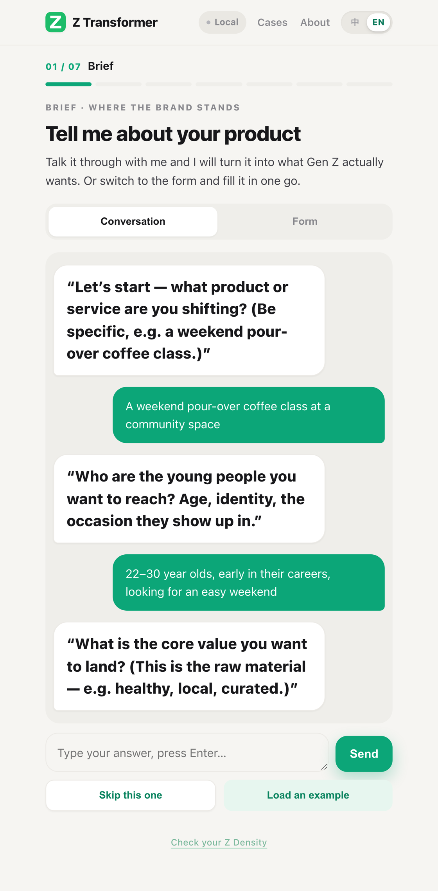
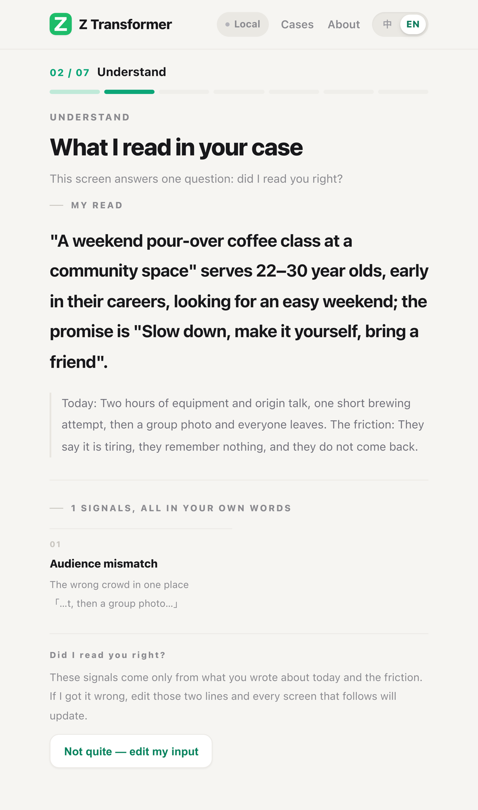
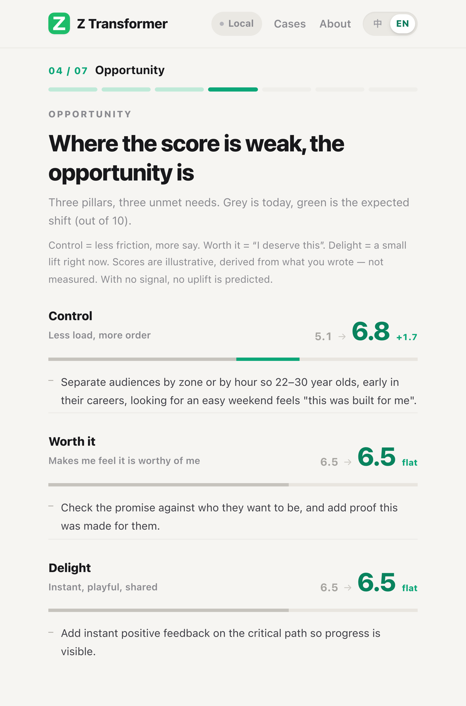
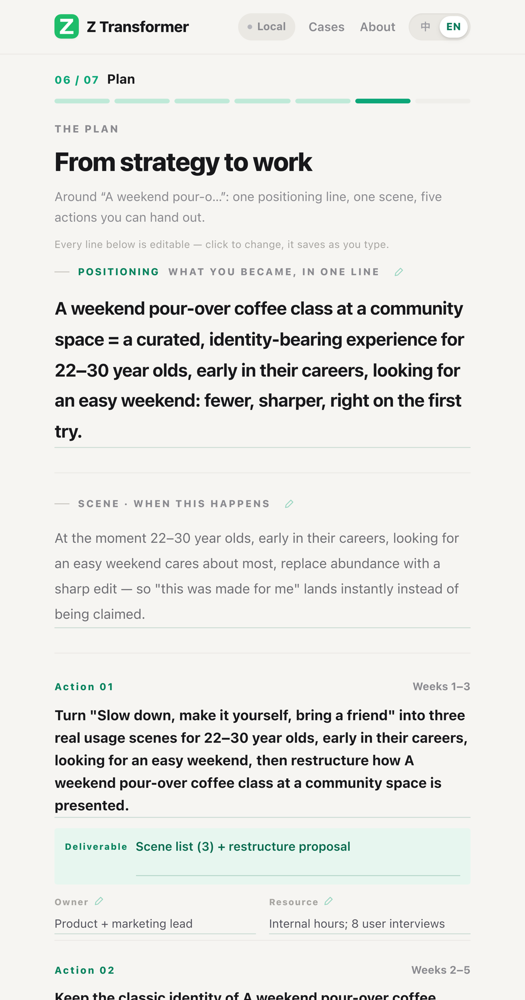

# Z Transformer · Keep up with Gen Z

> Turn any product or service into something this generation actually wants.
> Three pillars · five shifts · a 13-slide case, one click. Front-end only, free, no sign-up.

[中文](README.md) · [One-pager · EN](promo-en.html) · [一页宣传单 · 中文](promo-zh.html)

---

## Open and use

| Entry | What it is | Link |
| --- | --- | --- |
| **Full Pro** | Seven-screen case, editable throughout, PPT export | [Open now](https://z-translator.app.workbuddy.host/?sharecode=FVZKPT3F7M) |
| GitHub Pages mirror | Same build, plain static hosting | [Open](https://davidma1973simu.github.io/workbuddy-agents-marketplace/ztranslator/) |
| **Z Density** | The quick scan: one photo, a playful read in 30 seconds | [Open](https://z-density-game.app.workbuddy.host/?sharecode=DFPZX3LDV3) |
| One-pager | A4 portrait, printable source | [EN](promo-en.html) / [中文](promo-zh.html) |
| Ready-to-share PDF | Same layout, one A4 page | [EN](promo-en.pdf) / [中文](promo-zh.pdf) |

Switch languages with the 中 / EN toggle in the header, or use `?lang=en` (Pages) and `&lang=en` (share link).

## Screens and real output

These are real screenshots from one full run — the case is "a weekend pour-over coffee class at a community space". Not mockups.



*Home · five questions, no form to fill in. Switch to the form in one click*



*Understand · one question only: did I read you right? Every signal comes from your own words*



*Opportunity · three-pillar scores: 5.1 today → 6.8 after. The gap is the opportunity*



*The plan · one positioning line, one scene, five actions each with owner, deliverable and window*

Chinese screens: [README.md](README.md). All originals in [`screenshots/`](screenshots).

## What it fixes

Good value gets lost when it still speaks the language of the previous generation.
Z Transformer reframes "why won't they buy" into work you can hand out: five shifts across product, packaging, messaging, channel and community, plus one positioning line, one scene and five concrete actions.

## Method

- **Three pillars**: Control / Worth it / Right now
- **Five shifts**: Product / Packaging / Messaging / Channel / Community (after P&G's five shifts)
- **Seven screens**: Brief → Understand → Reframe → Opportunity → Shifts → Plan → Export

## Three steps

1. Answer five questions (product, audience, value, status quo, friction), or hit **Load an example** to watch the typed conversation.
2. Hit **Generate the case** and walk the screens. Any text with a faint green underline is editable and saves as you type.
3. **Export the deck** (13 slides) on the last screen. Cases are archived under **Cases** for later review.

## Reasoning engine

| Mode | What happens |
| --- | --- |
| Local reasoning (default) | Built-in rules run all seven steps. No network, no key, shallower but complete. |
| Bring your own model | Pick DeepSeek / OpenAI / Gemini in Settings, paste a key, and the same input gets real reasoning. |

Keys stay in this browser and are never uploaded. A case-anchor guard checks model output: if it drifts into a different product category, the app falls back to local reasoning with a quiet notice.

## Privacy

No backend, no account, no analytics. Input and cases live in `localStorage` only; clearing browser data removes everything.

## Run locally / deploy

```bash
git clone https://github.com/davidma1973simu/workbuddy-agents-marketplace.git
cd workbuddy-agents-marketplace/ztranslator
python3 -m http.server 8000
# http://localhost:8000/
```

Opening `index.html` directly works too. PPT export needs `pptxgen.bundle.js` beside it; PWA install needs http(s). Any static host works — this repo uses GitHub Pages on `main`.

## Files

| File | Purpose |
| --- | --- |
| `index.html` | The whole app (all CSS / JS inline) |
| `pptxgen.bundle.js` | Bundled PPT generator |
| `manifest.webmanifest` / `sw.js` / `app-icon.png` | PWA install and icon |
| `promo-en.html` / `promo-zh.html` | A4 one-pager sources, QR codes inlined, single-file distribution |
| `promo-en.pdf` / `promo-zh.pdf` | Same layout as one-page A4 PDFs |
| `screenshots/en-*.png` / `screenshots/zh-*.png` | Real UI screenshots, both languages (home / form / understand / opportunity / shifts / plan) |
| `README.en.md` / `README.md` | This document in EN / ZH |

To export a one-pager: open in a browser → Print → Save as PDF → A4, margins None, enable Background graphics.

## Keywords

Gen Z · Generation Z · generation gap · brand rejuvenation · product transformation · three pillars · P&G five shifts · design thinking · positioning · market fit · transformation canvas · one-pager · bilingual

---

© David Ma · [Main repository](https://github.com/davidma1973simu/workbuddy-agents-marketplace)
